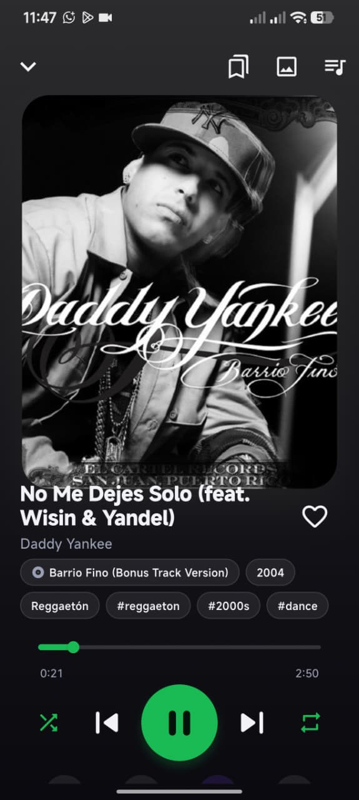
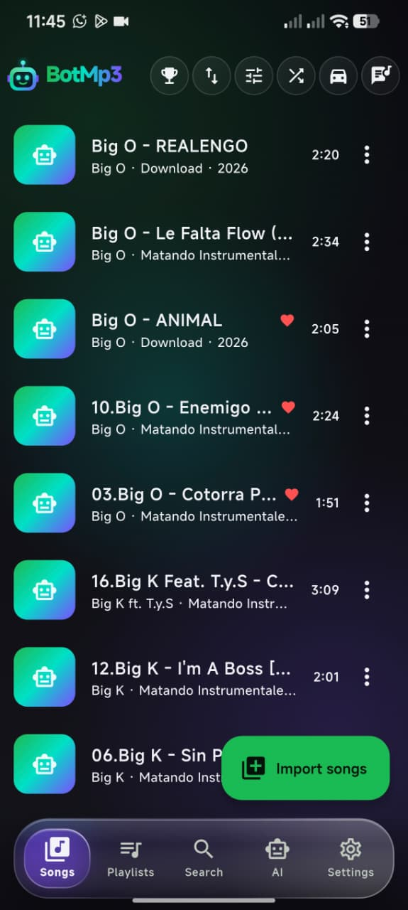
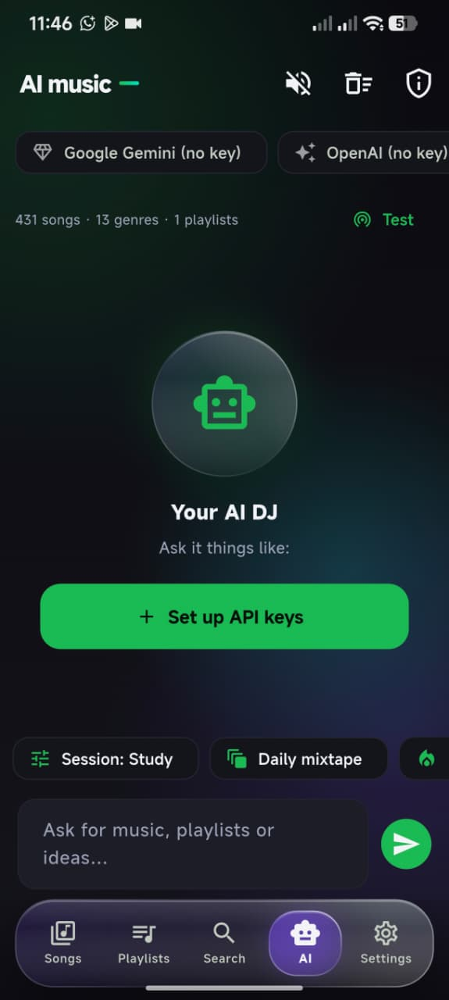
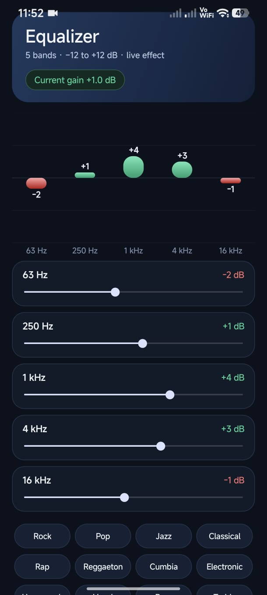
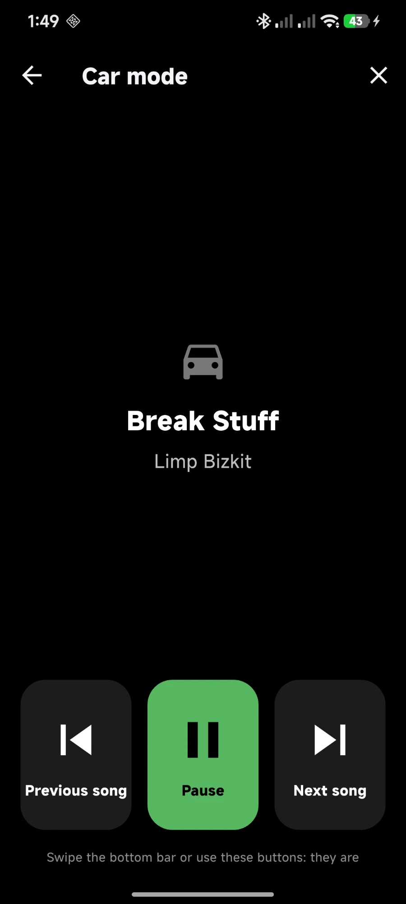
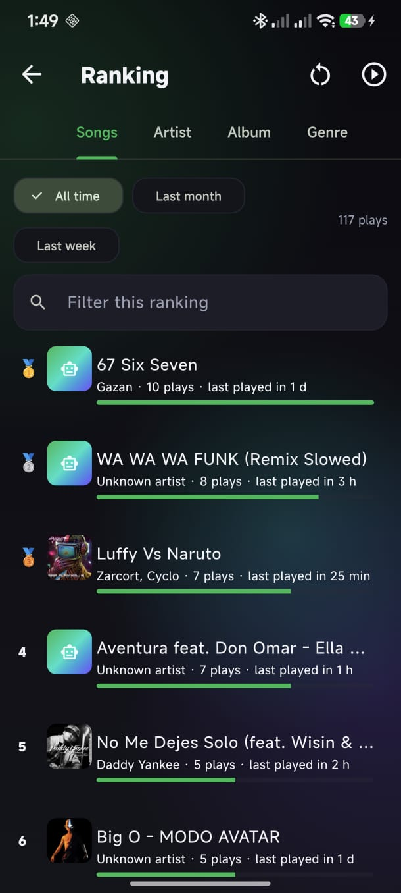

# 🤖🎵 BotMp3 — reproductor de música offline con DJ de IA

**BotMp3** es un reproductor de música para Android que funciona **100 % sin conexión**, con
tema oscuro de cristal (*Liquid Glass*), y un **DJ de IA opcional** que funciona con tu propia
clave de **DeepSeek, Google Gemini, OpenAI o Claude**.

Sin anuncios, sin cuentas y sin rastreo: tu música nunca sale del teléfono.

> 🇬🇧 *Offline music player for Android with an optional AI DJ (DeepSeek, Gemini, OpenAI or
> Claude, using your own key). No ads, no accounts, no tracking. Available in 10 languages.*

**Versión actual: 1.9.133** · Android 7.0+ · arm64 · Licencia **GPL-3.0**

<p>
  
  
  
  
  
  
</p>

---

## 📥 Descargar

- **APK:** en [Releases](https://github.com/pandaman8821/BotMp3/releases/latest) (descarga el
  archivo `BotMp3-x.y.z.apk` e instálalo en el móvil).
- **F-Droid:** petición de inclusión en preparación (receta en
  [`metadata/com.botmp3.app.yml`](metadata/com.botmp3.app.yml)).

> La APK de F-Droid estará firmada con la clave de F-Droid: para pasar de una a otra hay que
> desinstalar la que tengas.

---

## ✨ Qué hace

### 🎧 Reproductor
- Biblioteca local con **importación automática** de la música del dispositivo (MediaStore) y
  carátulas de álbum.
- MP3, M4A, AAC, OGG, OPUS, FLAC, WAV y AIFF.
- **Cola**, aleatorio sin repeticiones, repetir, reproducir a continuación y gestos.
- **Ecualizador de 5 bandas** (−12 a +12 dB) con preajustes por género.
- **Volumen por canción** y **ReplayGain**.
- Controles en la **pantalla de bloqueo**, auriculares, reloj y Android Auto.
- **Widget** de pantalla de inicio y **modo coche** con botones grandes.
- **Letras** (`.lrc`), editor de **metadatos** y editor de **carátulas** (filtros, brillo,
  contraste, texto…).
- Listas propias, carpetas, artistas, álbumes, historial y detector de **duplicados**.
- **Ranking** de lo que más escuchas (canciones, artistas, álbumes y géneros) por periodo.
- **Tendencias**: lo más escuchado en tu país, con aviso diario opcional.
- **Copias de seguridad** automáticas de la biblioteca y las listas.

### 🤖 DJ de IA (opcional)
- **Chat musical**: pide recomendaciones, listas o ideas y la app **ejecuta las órdenes**
  (reproducir, crear listas, editar metadatos, volumen…).
- **Modo DJ**: elige las siguientes canciones de tu biblioteca y explica por qué.
- Sesiones (estudio, fiesta, entrenamiento…), *mixtape* diario y cola infinita.
- **Responde en el idioma en que le escribes**; si no hay texto tuyo (DJ automático), usa el
  idioma de la app.
- Respuestas habladas (voz) en el idioma de la app.
- Muchas órdenes funcionan **sin clave y sin conexión** gracias a un intérprete local.

| Proveedor | Modelos |
|---|---|
| DeepSeek | `deepseek-flash` (recomendado), `deepseek-v4-pro` |
| Google Gemini | `gemini-3.8-flash`, `gemini-3.6-flash`, `gemini-2.5-pro`, … |
| OpenAI | `gpt-4.1`, `gpt-4.1-mini`, `gpt-4o`, `o4-mini`, … |
| Anthropic Claude | `claude-sonnet-4`, `claude-3-7-sonnet`, `claude-3-5-haiku` |

También puedes escribir cualquier otro identificador de modelo con **«Otro…»**.

### 🌍 Idiomas
Español, inglés, alemán, francés, italiano, portugués (Brasil), japonés, coreano, hindi y chino
simplificado.

---

## 🔐 Privacidad

- La música, las listas, las carátulas y el historial **nunca salen del dispositivo**.
- La IA es **opcional** y está desactivada hasta que añades una clave. Solo se envía al
  proveedor que elijas el texto que escribes y un catálogo compacto de tu biblioteca (título,
  artista, álbum, año, género y etiquetas).
- Las claves se guardan **cifradas** con el Android Keystore y no se incluyen en las copias de
  seguridad.
- Las tendencias usan un servicio público sin clave ni cuenta.

Por estas conexiones opcionales, F-Droid marca la app con la antifunción `NonFreeNet`.
Más detalles en [`PRIVACY.md`](PRIVACY.md).

---

## 🛠️ Compilar

| Herramienta | Versión |
|---|---|
| Flutter / Dart | **3.47.7** / 3.13.5 |
| JDK | **21** (no uses 25) |
| Gradle / AGP / Kotlin | 8.14.3 / 8.11.1 / 2.2.20 |
| Android SDK | compileSdk 36 · minSdk 24 · targetSdk 36 |
| NDK | r27c (27.2.12479018) |

```bash
flutter pub get
flutter test
flutter build apk --release --target-platform android-arm64
```

La APK queda en `build/app/outputs/flutter-apk/app-release.apk`.

> La firma de release usa `android/app/botmp3-release.jks`, que **no está en el repositorio**.
> Sin ella, el release se firma con la clave de depuración.

### Publicar una versión nueva
1. Sube `version:` en `pubspec.yaml` (por ejemplo `1.9.134+190`).
2. Añade el changelog en `fastlane/metadata/android/{es-ES,en-US}/changelogs/<versionCode>.txt`.
3. Crea la etiqueta `v1.9.134` y súbela: F-Droid detecta las versiones nuevas por etiquetas.
4. Publica la APK en **Releases** (las APK no se guardan en el repositorio).

---

## 🗂️ Estructura

```
lib/
├── core/        tema, constantes, textos traducidos, utilidades
├── models/      canciones, listas y mensajes de IA
├── services/    biblioteca, reproductor, metadatos, tendencias, copias…
│   └── ai/      clientes de DeepSeek, Gemini, OpenAI y Claude + orquestador del DJ
├── providers/   estado de la app (biblioteca, reproductor, IA, ajustes)
├── screens/     canciones, listas, búsqueda, IA, reproductor, ranking, modo coche…
├── widgets/     cristal, mini reproductor, carátulas, robot animado…
└── l10n/        traducciones (10 idiomas)
test/            pruebas automáticas (flutter test)
fastlane/        ficha de la tienda: descripciones, capturas y changelogs
metadata/        receta de compilación para F-Droid
```

---

## 📄 Licencia

BotMp3 es software libre bajo la licencia **GNU GPL v3** (ver [`LICENSE`](LICENSE)).
Todas sus dependencias son libres (MIT, BSD o Apache 2.0). El uso de cada API de IA se rige por
los términos de su proveedor.
